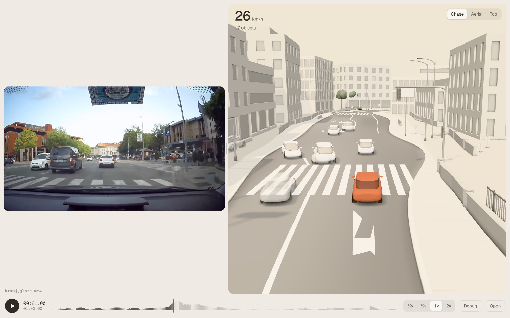
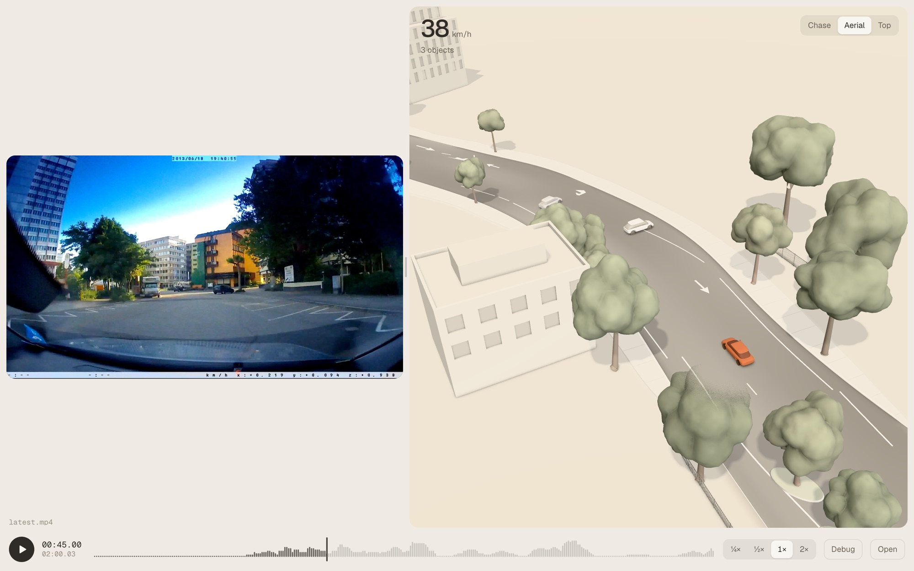
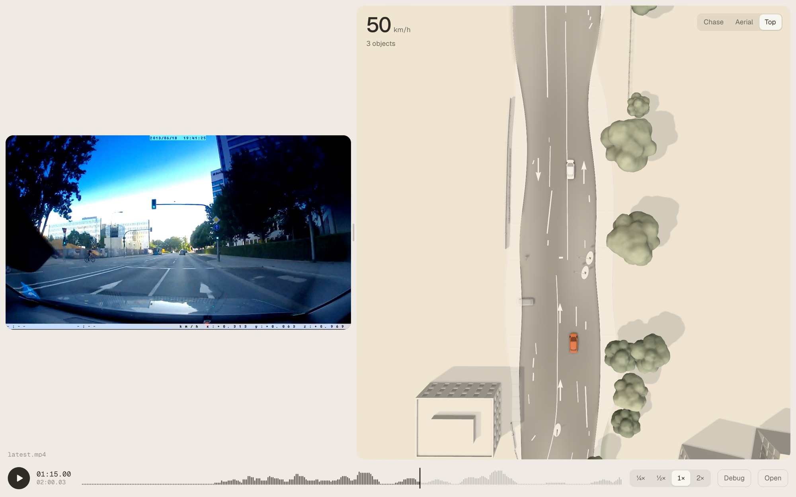
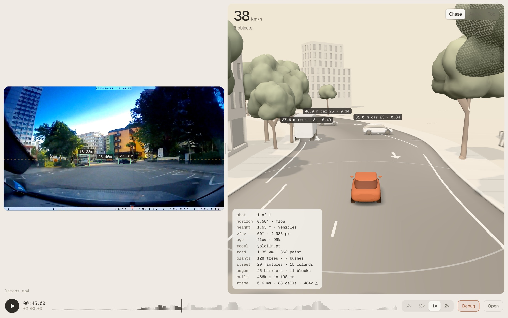
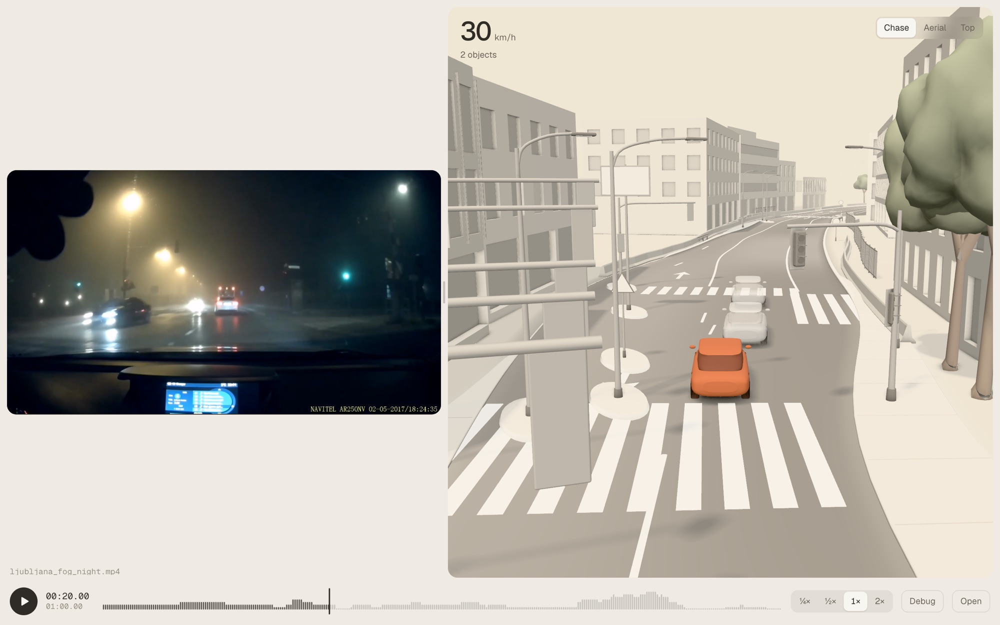

# clayview

A Tesla-style clay 3D view of the traffic around a car, built from camera footage. Give it a dashcam clip and it plays the clip beside a matte clay model of the same scene: every car, truck, bus, motorcycle, bicycle and person, placed on a rebuilt street around you.



<sub>Kranj, Slovenia, chase view. Ego is the terracotta car. Footage by Renato Lozinšek, CC BY 3.0; see [Credits](#credits).</sub>

It's a toy. It doesn't drive anything, it isn't a driver aid, and it shouldn't be trusted for anything.

Today it works on recorded clips only. Live cameras on a Pi are the next phase and aren't built. The camera placement study and its interactive planner are in [`docs/camera-layout/`](docs/camera-layout/README.md).

## Quick start

You need [uv](https://docs.astral.sh/uv/), [bun](https://bun.sh) and ffmpeg. With [mise](https://mise.jdx.dev), `mise trust && mise install` gets the pinned versions.

```sh
git clone https://github.com/snehanchakravarthi/clayview.git
cd clayview
uv sync
cd viewer && bun install && cd ..
```

The first run downloads the YOLO weights, the car view model and the street model into `models/`, about 1 GB in total.

No footage ships with the repo. If you don't have a clip, the eval harness can fetch an openly licensed one. This pulls the whole Kranj video from Wikimedia Commons and cuts a minute of it:

```sh
uv run python tools/eval/eval.py fetch kranj_glare
uv run clayview process clips/eval/kranj_glare/clip.mp4
```

## Run it on a clip

Put a clip in `clips/`, which is gitignored, and process it:

```sh
uv run clayview process clips/drive.mp4
```

This writes `out/drive.scene.json` and prints a summary of what it found. Then start the viewer:

```sh
cd viewer
bun run dev
```

Open <http://localhost:5199> and press **Open latest**. You can also drop a scene file and its video anywhere on the page, or use **Choose files**.

The clip has to be something your browser can play. H.264 MP4 is the safe choice. Old `.ogv` files need converting first:

```sh
ffmpeg -i clip.ogv -c:v libx264 -crf 23 -an clip.mp4
```

### Camera flags

The pipeline assumes a pinhole camera, level with the horizon row. A point on the road at image row `y` is this far ahead:

```
d = f * h / (y - horizon)      f: focal length in pixels, h: camera height
```

That is precise up close, but one pixel is worth `d²/(f*h)` metres, so it falls apart near the horizon. It also needs the bottom of the car to be visible. So each box gets a second estimate from a typical real size, `d = f * W / width_px`, and the two are blended by how much each can be trusted at that range. Objects that rely on the size estimate are flagged `size_prior`, and those with no usable ground contact are flagged `no_ground`.

Clips from unknown cameras are calibrated per shot, so a compilation can change camera at every cut.

| Flag | Default | What it does |
| --- | --- | --- |
| `--vfov` | `60` | Vertical field of view in degrees. **This sets the scale of every distance and can't be estimated from the clip.** A wider real lens than you've set makes everything read too far away. |
| `--height` | `auto` | Camera height in metres. `auto` works it out from the widths of rear-on cars. Falls back to 1.3. |
| `--horizon` | `auto` | Horizon row, in pixels or as a fraction under 1. `auto` uses the focus of expansion of the road flow, then car widths, then mid-frame. |
| `--pitch` | | Camera pitch in degrees, down is positive. Sets the horizon instead. |
| `--ego-speed` | `auto` | Speed in km/h, `auto` from road flow, or `off` to work in relative motion only. |
| `--max-range` | `120` | Clamp distance in metres. Objects past it are flagged `clamped`. |
| `--model` | `models/yolo11n.pt` | YOLO weights. |
| `--device` | `auto` | `auto`, `mps`, `cuda` or `cpu`. |
| `--no-views` | | Skip the car view model. Faster, but headings get worse. |
| `--no-world` | | Skip the street model. No real road, trees or buildings. |
| `--imgsz` | `960` | Inference size. Higher finds smaller, further cars. |
| `--stride` | `1` | Process every Nth frame. |
| `--limit` | | Stop after this many seconds. |

Detections, car views and street labels are cached, so re-running with a different camera flag takes seconds. Pass `--fresh` to redo them.

## Viewer controls

| Key | Action |
| --- | --- |
| Space | Play or pause |
| ← → | Skip 5 seconds |
| , . | Step one frame |
| 1 2 3 | Chase, aerial and top views |
| D | Debug: distances, flags, boxes on the video, horizon and calibration |

Drag the clay scene to orbit it. The bars on the timeline show how much traffic is in view, and terracotta ticks mark hard cuts.

<p>
  
  
</p>

<sub>Aerial and top views of the urban test clip.</sub>

The built viewer (`bun run build`) is plain static files with no backend. `?scene=<url>&video=<url>` opens a scene from any URL.

If the output looks wrong, press D. The yellow line should sit on the real horizon, and the pink one on the top of the hood. The panel shows how each shot was calibrated, and `uv run clayview stats out/drive.scene.json` prints the numbers.



## How it works

1. **Detect and track.** YOLO finds road users in every frame and ByteTrack links them. Tracks are stitched across gaps and filtered. Detections are cached, so later steps can be re-run in seconds.
2. **Find the shots and calibrate each one.** Hard cuts are found by image structure, so exposure jumps and wiper sweeps don't count. Each shot gets its own horizon from the focus of expansion of the road flow, a camera height from the widths of cars, and the row where the hood starts.
3. **Measure ego's motion.** Speed and yaw come from how the road moves between frames. A Kalman filter with an RTS backward pass smooths every object in ego's frame, so parked cars stay parked as they slide past.
4. **Place and orient objects.** Each box becomes a position on the road from the ground and size estimates above. Heading combines box shape, motion, the road direction from ego's path and an image model that reads the angle a car is seen from.
5. **Rebuild the street.** A street model labels road edges, paint, trees, poles and buildings. They are projected onto a flat road and joined along ego's estimated path.
6. **Play it.** A Three.js viewer draws the scene beside the video. Its state at any time is a pure function of that time, so scrubbing is exact.

The scene file is the only link between the Python half and the viewer. Its shape is defined by `src/clayview/core/scene.py` and `viewer/src/data/scene.ts`:

```json
{
  "version": 2,
  "metadata": { "source": {}, "camera": {}, "model": {}, "egoMotion": {} },
  "segments": [{ "index": 0, "startFrame": 0, "endFrame": 3600, "start": 0, "end": 120, "camera": {} }],
  "frames": [
    {
      "frame": 1875, "t": 62.5, "segment": 0,
      "ego": { "speed": 12.05, "yaw": -0.00431, "pose": [-3.1, 688.2, 0.07] },
      "objects": [
        {
          "id": 48, "class": "car", "x": -8.35, "y": 9.82,
          "heading": -0.349, "confidence": 0.592, "flags": [],
          "box": [0.0983, 0.6211, 0.1868, 0.7013]
        },
        {
          "id": 50, "class": "car", "x": -7.24, "y": 0.33,
          "heading": 0.248, "confidence": 0.194, "flags": ["held", "low_conf"]
        }
      ]
    }
  ],
  "world": { "segments": [{ "segment": 0, "road": [], "markings": [], "objects": [], "buildings": [], "barriers": [] }] }
}
```

Positions are in metres in the ego frame: `x` right, `y` forward, measured to the object's centre. Heading is in radians over the ground: 0 is ego's direction, positive turns right. `box` is the detector's box as fractions of the frame, and is missing on `held` frames. `pose` is ego's position and yaw in its shot's street frame, which restarts at every cut. `world` is the rebuilt street per shot, and is `null` with `--no-world`.

Flags are `size_prior`, `no_ground`, `truncated` (cut by a frame edge), `clamped`, `low_conf` and `held` (no detection this frame; the position comes from the filter).

## How well it works

The main check is one minute of [comma2k19](https://github.com/commaai/comma2k19), a public MIT driving dataset with CAN speed, pose and radar to measure against. Its focal length is published, so these figures use it and test everything else. Before is the pipeline as it was before [#1](https://github.com/snehanchakravarthi/clayview/pull/1), which fixed what this check found.

| Measure | Before | Now | Truth |
| --- | --- | --- | --- |
| False cuts (wipers running) | 16 | 0 | 0 |
| Ego speed vs CAN | 0.61× | 0.95× | 1× |
| Net yaw drift | +29°/min | −2°/min | +0.4°/min |
| Horizon error | 5.2 px | 2.0 px | 0 |
| Distance vs radar, 20–40 m | 1.01× | 0.93× | 1× |
| Distance vs radar, 40–70 m | 0.88× | 0.90× | 1× |

It also runs on 14 clips from other cameras and countries: snow, night fog, glare, rain, a tunnel, Dhaka traffic and a portrait phone. Most have no measured truth, so they mostly catch crashes, false cuts and implausible numbers. Known failures remain:

- **Highway speeds collapse.** On a Croatian motorway at 106–131 km/h, read from the clip's speed overlay, ego speed came out at a median of 0.9 km/h; a Maryland interstate at about 115 km/h read 16. The fast road near the car isn't tracked, so the static dash wins. Speed has only been checked up to about 60 km/h, so treat the street rebuild on fast roads as broken for now.
- Wide-angle lenses read speed low: 0.63× on a Bled clip with a speed overlay. Focal length can't be recovered from a clip, so `--vfov` has to be right.
- A camera tilted up at the sky can't read speed.
- Interior POV clips, with the steering wheel in frame, aren't refused.



<sub>Ljubljana at night in fog. Footage by Renato Lozinšek, CC BY 3.0; see [Credits](#credits).</sub>

### The eval harness

`tools/eval/` runs the pipeline over the clips in `clips.json` and scores each against what's known about it. Truth is uneven on purpose: comma2k19 has CAN speed, vehicle poses and radar, Bled has a speed overlay read by eye, and the rest only say what's certain from the frames.

```sh
uv run python tools/eval/eval.py fetch            # download each clip and cut its listed stretch
uv run python tools/eval/eval.py run              # process and score every clip
uv run python tools/eval/eval.py run bled_rollei --fresh
uv run python tools/eval/eval.py score            # rescore existing scene files
```

## Limitations

- **Distances are estimates with an unknown scale.** `--vfov` is a guess for any clip you didn't film yourself. Expect the relative layout to be good and absolute metres to be off by 20% or more.
- **Lenses are assumed perfect.** Wide dashcam lenses bend straight lines, which matters most at the edges of the frame.
- **The road is assumed flat.** Hills move the true horizon, and calibration is per shot, not per frame.
- **Ego speed comes from road texture.** It's checked against real speed on comma2k19 and two speed overlays, and it fails at highway speed (see above). Bare asphalt, night and rain will all hurt it.
- **Headings are approximate.** On 32 hand-labelled cars from the test clips, the median error is about 32° and 12% of cars face the wrong way. That's a small sample on one dashcam. The view model is often wrong on cars partly hidden by a dash mount, and small, far cars are weak.
- **The street is rebuilt from one forward camera.** It is not survey accurate. Curbs, paint, trees, poles and buildings are projected onto a flat road and joined along ego's estimated path, so errors in speed, yaw or calibration bend the map. Paint near the car can be about a metre off and arrows can smear. Anything the camera never saw clearly is missing, and tree heights run low when a canopy leaves the frame.
- **Only one camera sees forward.** Things that pass you coast briefly and fade out. Nothing is known behind or beside you.
- **`yolo11n` is small.** It misses distant objects and sometimes confuses cars and trucks. `--model` takes a larger one.

## Project layout

The pipeline is in `src/clayview/`, with a numpy-only core in `src/clayview/core/` that a test keeps free of YOLO and OpenCV. The viewer is in `viewer/`, and the eval harness in `tools/eval/`. [`AGENTS.md`](AGENTS.md) has the module map, the commands and the project's conventions.

```sh
uv run pytest
uv run ruff check && uv run ruff format --check
cd viewer && bun run test && bun run typecheck
```

## Licence

A licence for clayview's own code hasn't been chosen yet, so there is no `LICENSE` file. Its dependencies come with terms of their own:

- [Ultralytics YOLO](https://github.com/ultralytics/ultralytics), which does detection and tracking, is AGPL-3.0. That is copyleft, and it covers software offered over a network as well as software you distribute.
- The street model is Mask2Former trained on [Mapillary Vistas](https://huggingface.co/facebook/mask2former-swin-large-mapillary-vistas-semantic). Its Hugging Face licence is listed as `other`, and Vistas is a non-commercial research dataset.
- The car view model is the ConvNeXt from [Car Full View Dataset](https://www.mdpi.com/2079-9292/12/24/4947) (Catruna et al., 2023), Apache-2.0 on [Hugging Face](https://huggingface.co/fort-cyber/Car-orientation-image). `clayview` checks its SHA-256 after download.

Clips and model weights are never committed. The weights are downloaded on first run, and eval clips are fetched from their sources.

## Credits

The screenshots include frames from these videos, scaled and shown beside the clay render:

- Kranj ([`hero-city.jpg`](docs/images/hero-city.jpg)): [On the Road: Driving through Kranj](https://commons.wikimedia.org/wiki/File:On_the_Road-_Driving_through_Kranj.webm) by Renato Lozinšek, [CC BY 3.0](https://creativecommons.org/licenses/by/3.0/), via Wikimedia Commons.
- Ljubljana ([`night-fog.jpg`](docs/images/night-fog.jpg)): [On the Road: Foggy Ljubljana](https://commons.wikimedia.org/wiki/File:On_the_Road-_Foggy_Ljubljana.webm) by Renato Lozinšek, [CC BY 3.0](https://creativecommons.org/licenses/by/3.0/), via Wikimedia Commons.
- The urban test clip ([`aerial.jpg`](docs/images/aerial.jpg), [`debug.jpg`](docs/images/debug.jpg), [`top.jpg`](docs/images/top.jpg)): [Dashcam recording example - Panorama II BlackBox Dashcam daylight](https://commons.wikimedia.org/wiki/File:Dashcam_recording_example_-_Panorama_II_BlackBox_Dashcam_daylight.mp4.ogv) by Fernost, Wikimedia Commons, [CC0](https://creativecommons.org/publicdomain/zero/1.0/).

The eval clips are listed with their authors and licences in [`tools/eval/clips.json`](tools/eval/clips.json). comma2k19 is by [comma.ai](https://github.com/commaai/comma2k19), MIT.

## Hosted version

There's no hosted version. clayview runs locally, on your own clips.
